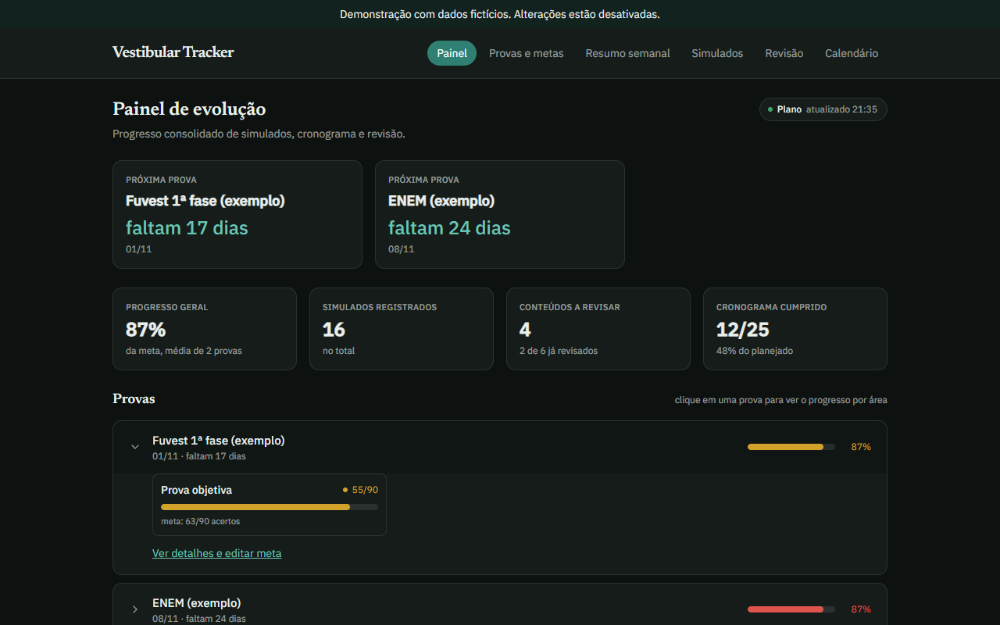
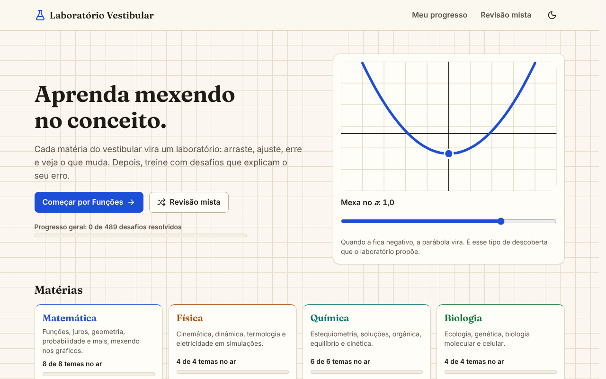
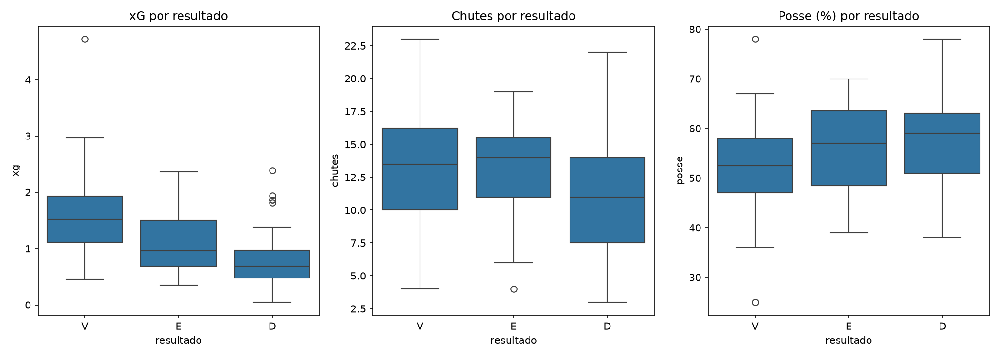
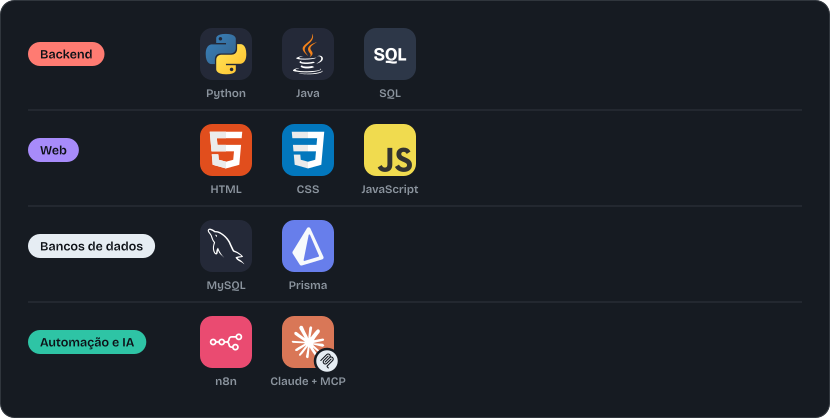

  

Oi, eu sou o Henrique 👋

Estudo tecnologia todos os dias e aprendo melhor com a mão na massa, construindo, errando e anotando o que descobri. Agora estou explorando o que acontece quando a IA se conecta a automações e a bancos de dados.

## Projetos em destaque

<table>
  <tr>
    <td width="44%" valign="top">
      
    </td>
    <td valign="top">
      <b><a href="https://github.com/henrifernandez/vestibular-tracker-open">Vestibular Tracker</a></b>
      
Acompanha simulados, erros e plano de estudo com meta em % para qualquer prova, como ENEM, Fuvest e Unicamp. Os assuntos que você erra duas vezes entram sozinhos numa fila de revisão, e há sincronização opcional com o Notion.

      Next.js · TypeScript · Prisma · Docker · CI com testes 
      <a href="https://vestibular-tracker-open.vercel.app">Demo online</a> · <a href="https://github.com/henrifernandez/vestibular-tracker-open">Código</a>
    </td>
  </tr>
  <tr>
    <td width="44%" valign="top">
      
    </td>
    <td valign="top">
      <b><a href="https://github.com/henrifernandez/laboratorio-vestibular">Laboratório Vestibular</a></b>
      
Cada matéria do vestibular vira um laboratório interativo, em que você arrasta, ajusta e vê o conceito mudar. São quatro matérias, 489 desafios e nenhuma conta obrigatória. O projeto tem mais de 2 mil testes automatizados e passou por auditoria de acessibilidade (WCAG 2.2 AA).

      React · Vite · TypeScript · Vitest · GitHub Actions 
      <a href="https://laboratorio-vestibular.vercel.app">Site</a> · <a href="https://github.com/henrifernandez/laboratorio-vestibular">Código</a>
    </td>
  </tr>
  <tr>
    <td width="44%" valign="top">
      
    </td>
    <td valign="top">
      <b><a href="https://github.com/henrifernandez/sao-paulo-analise">Por que o São Paulo perde</a></b>
      
Análise estatística de 102 jogos do Brasileirão (2024 a 2026). O achado central é que, nas derrotas, o time tem mais posse de bola, mas cria menos chances de gol, com xG mediano de 0,69 contra 1,52 nas vitórias. Inclui testes de hipótese, regressão logística e um painel interativo.

      Python · pandas · SciPy · scikit-learn · Streamlit 
      <a href="https://github.com/henrifernandez/sao-paulo-analise/blob/main/RELATORIO.md">Relatório</a> · <a href="https://github.com/henrifernandez/sao-paulo-analise">Código</a>
    </td>
  </tr>
</table>

Mais sobre mim no [portfólio](https://enzohf.vercel.app).

## Em que estou trabalhando

<b>Aspen Core</b>

 

A Aspen Core é a empresa e o nome do software que controla a Aspen Key, uma chave de autenticação física. Quando conectada ao Aspen Network, a chave também passa a ser rastreada por Bluetooth. Atuo na parte de software, com backend, banco de dados e testes.

## Stack

  

## Ferramentas

  

## O que me interessa

IA aplicada e automação, ciência de dados, segurança e criptografia.
